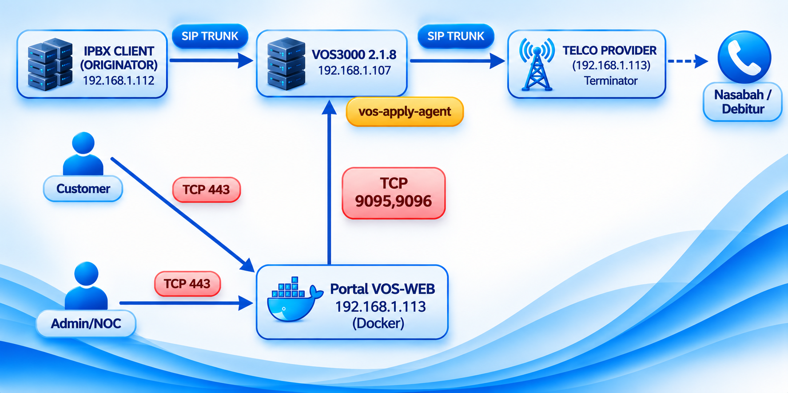

# VoxaGrid VOS-UI Production Distribution Suite
### Modern Multi-Tenant Web Management, NOC Analytics & Zero-Exposure Bridge for VOS3000 Softswitch

Paket rilis produksi terpadu untuk instalasi mandiri aplikasi **Portal VOS-WEB (`apps`)** dan **Host Softswitch Bridge Agent (`vos-apply-agent`)**.

---

## 1. Gambaran Arsitektur Ekosistem VOS-WEB



```text
  +-----------------------+          SIP TRUNK           +-----------------------+
  |     IPBX CLIENT       |    (Mapping Gateway / In)    |     VOS3000 2.1.8     |
  |     (ORIGINATOR)      | ---------------------------> |   Softswitch Server   |
  |   e.g. 192.168.1.112  |                              |   e.g. 192.168.1.107  |
  +-----------------------+                              +-----------+-----------+
                                                                     |
                                                                     | SIP TRUNK (Routing GW / Out)
                                                                     v
  +-----------------------+         Panggilan            +-----------------------+
  |   Nasabah / Debitur   | < - - - - - - - - - - - - -  |    TELCO PROVIDER     |
  |      (End User)       |                              |     (Terminator)      |
  +-----------------------+                              |   e.g. 192.168.1.113  |
                                                         +-----------------------+

  +-----------------------+                              +-----------------------+
  |   Customer / Admin    | ======= TCP 80 / 443 ======> |    Portal VOS-WEB     |
  |    (Web Browser)      |                              |   (Docker - apps)     |
  +-----------------------+                              +-----------+-----------+
                                                                     |
                                                                     | TCP 9095 & 9096
                                                                     v
                                                         +-----------------------+
                                                         |   vos-apply-agent     |
                                                         | (Di Server VOS3000)   |
                                                         +-----------------------+
```

---

## 2. Struktur Paket Distribusi

Paket ini dirancang modular agar dapat di-deploy pada **Server Terpisah (Dedicated Server — Sangat Direkomendasikan)** maupun pada **Mesin VOS3000 yang Sama (Co-located)**:

```text
/data/vos-ui-prod/
│
├── InfraVosWeb.png               # Diagram Arsitektur Infrastruktur VOS-WEB
├── README.md                     # Dokumen pengantar utama paket rilis
│
├── apps/                         # [1] Paket Portal VOS-WEB Server (Docker Compose Stack)
│   ├── deploy.sh                 # Skrip otomatis 1-click deployment VOS-WEB
│   ├── install.sh                # Symlink ke deploy.sh
│   ├── docker-compose.yml        # Orkestrator 4 container (Postgres, Redis, Middleware, Frontend)
│   ├── .env.example              # Template variabel lingkungan
│   ├── InfraVosWeb.png           # Diagram arsitektur sistem
│   ├── README.md                 # Panduan lengkap instalasi & operasional Portal VOS-WEB
│   ├── frontend/                 # Pre-built Vue 3 + Vite SPA bundle & Nginx runner
│   ├── middleware/               # Pre-compiled Go Middleware static binary & Alpine runner
│   ├── initdb/                   # Master schema database TimescaleDB (clean & verified)
│   ├── nginx/                    # Konfigurasi reverse proxy SPA, SSL, & WebSocket
│   ├── scripts/                  # Utilitas reset-http-server.sh (pemulihan darurat HTTP)
│   └── logs/                     # Direktori penyimpanan log container
│
└── vos-apply-agent/              # [2] Paket Host Softswitch VOS3000 Agent (Port 9095 & 9096)
    ├── deploy.sh                 # Skrip otomatis 1-click installer di mesin VOS3000
    ├── install.sh                # Symlink ke deploy.sh
    ├── agent.conf                # Konfigurasi security whitelist IP, secret, & MySQL lokal
    ├── attach.sh                 # In-JVM attacher ke proses vos3000d (Port 9095)
    ├── daemon.sh                 # Supervisi port 9095 & port 9096 (VosHostMonitor)
    ├── InfraVosWeb.png           # Diagram arsitektur sistem
    ├── README.md                 # Panduan lengkap instalasi & operasional Host Agent
    ├── lib/                      # Dependensi pustaka JDBC MySQL 5.1.49
    └── bin/                      # Direktori paket binary JAR terobfuskasi ProGuard
        ├── vos-apply-agent.jar   # Biner ProGuard terobfuskasi & ter-strip (112 KB)
        └── attach.jar            # Dynamic JVM attach bootstrap utility
```

---

## 3. Panduan Singkat Instalasi (Quick Start)

### Skenario A: Server Terpisah (Dedicated Server — Direkomendasikan ⭐)
1. **Di Server Portal VOS-WEB (misal IP `192.168.1.113`)**:
   Salin folder `apps` ke `/opt/vos-ui` dan jalankan `deploy.sh`:
   ```bash
   cd /opt/vos-ui
   bash deploy.sh
   ```
2. **Di Mesin Softswitch VOS3000 (misal IP `192.168.1.107`)**:
   Salin folder `vos-apply-agent` ke `/tmp/vos-apply-agent` dan jalankan `deploy.sh` dengan menyertakan IP Server Portal VOS-WEB:
   ```bash
   cd /tmp/vos-apply-agent
   bash deploy.sh 192.168.1.113
   ```
3. **Di Browser (`http://192.168.1.113`)**:
   Login sebagai `admin` (password default: `voxagrid`), buka menu **Server & License (`/settings`)**, edit node `vos-node-01`, masukkan IP VOS3000 (`192.168.1.107`), lalu klik **Save**.

---

### Skenario B: Server Bersama (Co-located / Single Server)
Jika Portal VOS-WEB diinstal langsung di mesin yang sama dengan VOS3000:
1. Jalankan `vos-apply-agent/deploy.sh 127.0.0.1` terlebih dahulu.
2. Jalankan `apps/deploy.sh`.

---
**VOS3000 Web Management © 2026 VoxaGrid Systems**  
Kontak & Dukungan Teknis: `info@voxagrid.net` | `masteringvoip@gmail.com` | [www.voxagrid.net](https://www.voxagrid.net)
