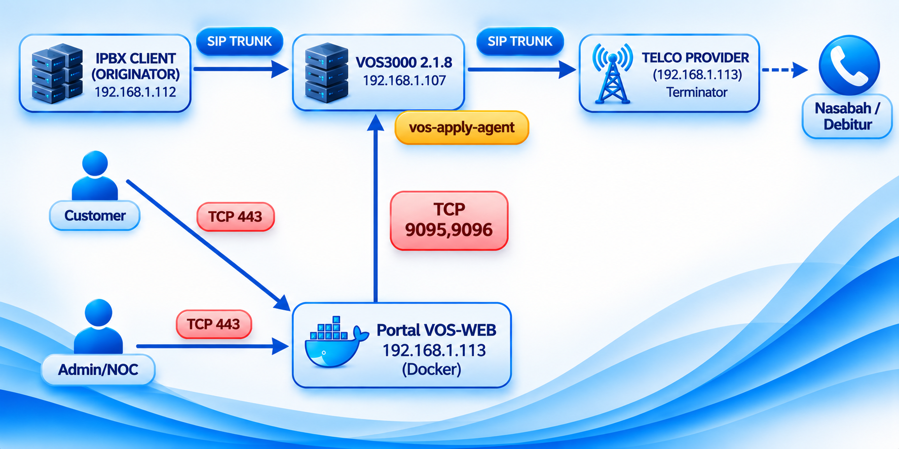
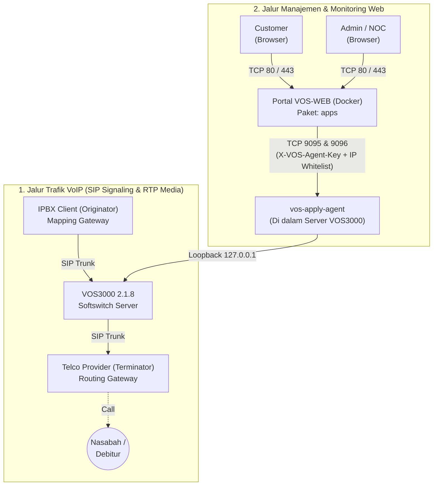

# Panduan Deployment Portal VOS-WEB (`apps`)
### VoxaGrid Enterprise Web Management & Go Middleware Suite for VOS3000

Dokumen ini adalah panduan resmi instalasi, arsitektur sistem, konfigurasi, dan pemeliharaan paket **`apps` (Portal VOS-WEB & Middleware)** pada server VPS atau Dedicated Server (Cloud / On-Premise).

---

## 1. Gambaran Umum & Topologi Arsitektur Sistem

Secara keseluruhan, ekosistem **VOS-WEB Management Suite** terdiri dari **2 komponen paket utama** yang saling terhubung:
1. **Paket `apps` (Portal VOS-WEB — Docker Stack)**: Dipasang pada server antarmuka web (VPS/Dedicated) yang diakses oleh **Admin/NOC** dan **Customer** melalui browser (`TCP 80 / 443`).
2. **Paket `vos-apply-agent` (Host Softswitch Agent)**: Dipasang langsung di dalam mesin **Softswitch VOS3000** sebagai jembatan komunikasi aman (*Zero-Exposure Bridge*) pada port **`TCP 9095 & 9096`**.



### Diagram Topologi Teknis (Terminal / ASCII View)
```text
====================================================================================================
                  JALUR TRAFIK VOIP / TELEPON (SIP SIGNALING & RTP MEDIA PLANE)
====================================================================================================

  +-----------------------+          SIP TRUNK           +-----------------------+
  |     IPBX CLIENT       |    (Mapping Gateway / In)    |     VOS3000 2.1.8     |
  |     (ORIGINATOR)      | ---------------------------> |   Softswitch Engine   |
  |   e.g. 192.168.1.112  |                              |   e.g. 192.168.1.107  |
  +-----------------------+                              +-----------+-----------+
                                                                     |
                                                                     | SIP TRUNK (Routing GW / Out)
                                                                     v
  +-----------------------+         Panggilan            +-----------------------+
  |   Nasabah / Debitur   | < - - - - - - - - - - - - -  |    TELCO PROVIDER     |
  |      (End User)       |                              |     (Terminator)      |
  +-----------------------+                              |   e.g. 192.168.1.113  |
                                                         +-----------------------+

====================================================================================================
                  JALUR MANAJEMEN & KONTROL WEB (MANAGEMENT & CONTROL PLANE)
====================================================================================================

  +-----------------------+                              +-----------------------------------------+
  |   Customer Portal     | ---+                         |         VOS3000 HOST SERVER             |
  | (Tenant Isolated UI)  |    |                         |                                         |
  +-----------------------+    |   HTTPS (TCP 80/443)    |  +-----------------------------------+  |
                               +-----------------------> |  |      vos-apply-agent (Daemon)     |  |
  +-----------------------+    |                         |  |  - Port 9095 : In-JVM Apply/Trace |  |
  |    Admin / NOC UI     | ---+                         |  |  - Port 9096 : API & MySQL Proxy  |  |
  | (Full Switch Control) |                              |  +-----------------+-----------------+  |
  +-----------------------+                              |                    | Loopback 127.0.0.1 |
              |                                          |        +-----------+-----------+        |
              v                                          |        v                       v        |
  +-----------------------------------------+            |  +------------+         +------------+  |
  |       Portal VOS-WEB (Paket apps)       |            |  | Tomcat API |         | MySQL 5.0  |  |
  |       e.g. 192.168.1.113 (Docker)       | ---------> |  | Port 6099  |         | Port 3306  |  |
  |  - vos-frontend   (Nginx :80/:443)      |    TCP     |  | (Terkunci) |         | (Terkunci) |  |
  |  - vos-middleware (Go API :8080)        | 9095, 9096 |  +------------+         +------------+  |
  |  - vos-postgres   (TimescaleDB :5532)   |            +-----------------------------------------+
  |  - vos-redis      (Redis Cache :6379)   |
  +-----------------------------------------+
```



### Penjelasan Alur Kerja Sistem:
1. **Alur Panggilan Telepon (Atas)**:
   * **IPBX Client (Originator)** mengirimkan panggilan masuk (*Ingress*) ke **VOS3000** melalui *Mapping Gateway*.
   * **VOS3000** memproses autentikasi, penomoran (*Caller ID Pool*), dan tarif, lalu meneruskan panggilan keluar (*Egress*) melalui *Routing Gateway* ke **Telco Provider (Terminator)** hingga terhubung ke **Nasabah / Debitur**.
2. **Alur Portal VOS-WEB ke VOS3000 (Bawah)**:
   * **Admin/NOC** dan **Customer** mengakses **Portal VOS-WEB** melalui browser pada port **TCP 80 / 443**.
   * **Customer** yang login hanya dapat melihat trafik panggilan aktif, kapasitas gateway, riwayat CDR, analitik kualitas rute, dan tagihan yang **100% terisolasi sesuai Account ID miliknya sendiri**.
   * **Portal VOS-WEB** berkomunikasi ke mesin **VOS3000** hanya melalui **TCP Port `9095` & `9096`** yang dijaga oleh **`vos-apply-agent`**:
     * **Port `9095` (`VosApplyAgent`)**: Mengeksekusi sinkronisasi konfigurasi langsung ke memori softswitch (*Apply*), perbaikan grup tarif, dan membaca file *SIP Packet Capture* (`/home/kunshi/mbx3000/trace/callflow_*`).
     * **Port `9096` (`VosHostMonitor`)**: Menjadi *Zero-Exposure Proxy* ke Tomcat API (`127.0.0.1:6099`) dan database MySQL (`127.0.0.1:3306`) di dalam mesin VOS3000, sekaligus memantau 10 service daemon VOS3000. Dengan demikian, port MySQL `3306` dan Tomcat `6099` di mesin VOS3000 **tetap tertutup rapat dari jaringan luar**.

---

## 2. Komponen Container di Dalam Paket `apps`

Paket `apps` berjalan di atas **4 container Docker terkoordinasi** menggunakan mode jaringan `network_mode: host` untuk latensi rendah ($\le 15\text{ ms}$):

| Container Name | Port Host | Image / Engine | Fungsi Utama |
| :--- | :--- | :--- | :--- |
| **`vos-frontend`** | `80` (HTTP) & `443` (HTTPS) | `nginx:1.25-alpine` | Antarmuka Web SPA, Reverse Proxy, SSL Termination, & Layer-7 Rate Limiting |
| **`vos-middleware`** | `8080` (Internal API/WS) | `alpine:3.19` (`vos-middleware`) | Backend Go Middleware, Sinkronisasi CDR, NOC Analytics, Caller ID Rotation, & Dynamic SSL Engine |
| **`vos-postgres`** | `5532` (Loopback) | `timescale/timescaledb-ha:pg15-latest` | Database OLTP & TimescaleDB Hypertable untuk penyimpanan CDR historis berindeks |
| **`vos-redis`** | `6379` (Loopback `127.0.0.1`) | `redis:7-alpine` | In-Memory Cache VOS API, Buffer CPS Realtime, Rate Limiting, & JWT Blacklist |

Seluruh data persisten disimpan di dalam Docker Named Volumes (`vos_pgdata` dan `vos_redisdata`), sehingga aman saat container di-restart atau diperbarui.

---

## 3. Spesifikasi Server Minimum (VPS / Dedicated)

* **Sistem Operasi yang Didukung (Otomatis Terdeteksi)**:
  * **RHEL Family**: AlmaLinux 8 / 9, Rocky Linux 8 / 9, CentOS Stream 8 / 9, RHEL 8 / 9
  * **Debian Family**: Ubuntu 20.04 / 22.04 / 24.04 LTS, Debian 11 / 12
* **CPU**: Minimal 2 vCPU (Rekomendasi: 4+ vCPU untuk trafik > 100 CPS)
* **RAM**: Minimal 4 GB (Rekomendasi: 8+ GB)
* **Storage**: Minimal 40 GB SSD / NVMe
* **Hak Akses**: `root` atau user dengan `sudo`
* **Kebutuhan Port Jaringan**:
  * **Inbound ke Server Portal VOS-WEB**: Port `80` (HTTP) dan `443` (HTTPS) untuk akses browser pengguna.
  * **Outbound dari Server Portal VOS-WEB ke Mesin VOS3000**: Port `9095` dan `9096` (TCP).

---

## 4. Urutan & Langkah Deployment End-to-End (1-Click Install)

Untuk melakukan instalasi mandiri dari awal, ikuti **3 tahap berurutan** berikut:

1. **Tahap 1**: Instal paket **`apps`** di Server Portal VOS-WEB (panduan di bawah ini).
2. **Tahap 2**: Instal paket **`vos-apply-agent`** di Mesin Softswitch VOS3000 dengan mendaftarkan IP Server Portal VOS-WEB (lihat panduan di `vos-apply-agent/README.md`).
3. **Tahap 3**: Hubungkan IP Mesin VOS3000 pada menu **Server & License (`/settings`)** di Portal VOS-WEB.

---

### Langkah 1: Unggah Paket `apps` ke Server Portal VOS-WEB
Salin folder `apps` ke server VPS/Dedicated Anda (direkomendasikan ditempatkan di `/opt/vos-ui` atau `/data/vos-ui`):

```bash
# Contoh menyalin dari komputer lokal ke Server Portal VOS-WEB
scp -r apps root@<IP_PORTAL_VOS_WEB>:/opt/vos-ui
```

### Langkah 2: Jalankan Script Instalasi Otomatis (`deploy.sh`)
Login ke Server Portal VOS-WEB melalui SSH sebagai `root`, masuk ke direktori instalasi, dan jalankan `deploy.sh` (atau `install.sh`):

```bash
ssh root@<IP_PORTAL_VOS_WEB>
cd /opt/vos-ui
bash deploy.sh
```

### Apa yang Dilakukan `deploy.sh` Secara Otomatis?
Script `deploy.sh` dirancang **Self-Healing & Zero-Manual-Prerequisites** (Anda tidak perlu menginstal Docker atau paket apa pun secara manual terlebih dahulu):
1. **Deteksi OS & Menonaktifkan Pemblokir Sistem**: Otomatis mendeteksi distro Linux, menonaktifkan SELinux (`Permissive`/`Disabled`), dan menghentikan `firewalld`.
2. **Instalasi Paket Esensial**: Otomatis memasang `curl`, `wget`, `jq`, `tar`, `gzip`, `openssl`, `ca-certificates`, `iproute`, `procps`, dan `net-tools`.
3. **Sinkronisasi Waktu**: Mengatur zona waktu server ke `Asia/Jakarta (WIB / UTC+7)` dan mengaktifkan `chronyd` (jika bukan container LXC).
4. **Instalasi Otomatis Docker CE & Compose Plugin**: Jika server belum memiliki Docker, script otomatis mendaftarkan repositori resmi Docker CE, menginstal `docker-ce` & `docker-compose-plugin`, serta menyalakan daemon Docker.
5. **Inisialisasi Machine-ID & Lisensi Evaluasi 7 Hari**: Memverifikasi `/etc/machine-id` dan otomatis mengaktifkan **7-Day Trial Evaluation Mode** (hingga 2 Node VOS3000) apabila file `license.lic` belum diisi.
6. **Pembangkitan Kredensial Acak (`.env`)**: Membuat file `.env` dari `.env.example` dengan password acak kriptografi (`openssl rand -hex 16`) untuk PostgreSQL (`DB_PASS`) dan Redis (`REDIS_PASS`).
7. **Menjalankan & Memverifikasi Stack**: Menjalankan `docker compose up -d --build`, menunggu keempat container berstatus `HEALTHY`, dan memverifikasi endpoint HTTP `200 OK` pada Backend (`:8080/health`) serta Nginx Web Gateway (`:80/health`).

---

## 5. Login Pertama Kali & Menghubungkan ke Mesin VOS3000

Setelah `deploy.sh` selesai, buka browser dan akses alamat IP atau domain Server Portal VOS-WEB Anda:

* **URL Web Dashboard**: `http://<IP_PORTAL_VOS_WEB>/`
* **Username Default**: `admin`
* **Password Default**: `voxagrid`

> [!IMPORTANT]
> Segera ubah kata sandi default `admin` setelah login pertama kali melalui menu **User Management (`/users`)** atau profil pengguna di pojok kanan atas.

### Menghubungkan Portal VOS-WEB dengan Node Softswitch VOS3000:
1. Pastikan Anda sudah menjalankan `bash deploy.sh <IP_PORTAL_VOS_WEB>` dari paket **`vos-apply-agent`** pada mesin softswitch VOS3000 Anda.
2. Di Web Dashboard VOS-UI, buka menu **Platform & Cluster Control $\rightarrow$ Server & License (`/settings`)**.
3. Klik tombol **Edit** pada node default (`vos-node-01`) atau klik **Add VOS Node**:
   * **Server ID**: Nama unik node (misal: `vos-node-01`, dapat diubah sesuai keinginan).
   * **Host / IP Address**: Masukkan IP mesin softswitch VOS3000 Anda (contoh pada gambar: `192.168.1.107`).
   * **API Connection Mode**: Pilih **`Agent Proxy (Port 9096) [Recommended]`**.
   * **DB Connection Mode**: Pilih **`Agent Proxy (Port 9096) [Recommended]`**.
   * **Agent Secret**: `voxagrid-agent-secret-2026` (sesuaikan dengan `AGENT_SECRET` pada `agent.conf` di mesin VOS3000).
4. Klik tombol **Test Web API**, **Test Agent (9095/9096)**, dan **Test MySQL** untuk memastikan seluruh indikator berstatus **CONNECTED / ONLINE**, lalu klik **Save**.

---

## 6. Konfigurasi HTTPS / SSL Certificate (Melalui Web UI)

Aplikasi VOS-UI dilengkapi fitur **Dynamic SSL Certificate & Web Server Listener Studio**:
1. Buka menu **Platform & Cluster Control $\rightarrow$ SSL & Web Server (`/system/ssl`)**.
2. Pada tab **Certificate Vault**, klik **Add / Issue Certificate** dan pilih salah satu metode:
   * **Self-Signed Generator**: Membuat sertifikat RSA 2048-bit instan (cocok untuk akses via IP lokal/publik tanpa domain).
   * **Let's Encrypt (ACME HTTP-01)**: Penerbitan dan perpanjangan sertifikat SSL resmi otomatis gratis untuk nama domain publik (pastikan DNS A-record domain sudah mengarah ke IP VPS dan port 80 terbuka).
   * **Custom Trusted CA**: Unggah sertifikat `.crt`/`.pem` dan `.key` komersial Anda sendiri.
3. Pindah ke tab **Web Server Listener**:
   * Pilih sertifikat pada **Active SSL Certificate**.
   * Aktifkan toggle **Enable HTTPS Listener (Port 443)**.
   * (Opsional) Aktifkan **Force HTTPS Redirect (HTTP $\rightarrow$ HTTPS)** jika ingin semua trafik HTTP dialihkan ke HTTPS.
   * Klik **Apply Configuration & Reload Nginx** (berjalan *zero-downtime*).

### Pemulihan Darurat HTTP (Jika Salah Konfigurasi SSL/Domain):
Jika Anda tidak sengaja mengaktifkan *Force HTTPS* pada domain/sertifikat yang salah sehingga tidak bisa mengakses Web UI, jalankan skrip darurat berikut melalui SSH:
```bash
cd /opt/vos-ui
bash ./scripts/reset-http-server.sh
```
Skrip tersebut akan otomatis mereset listener Nginx kembali ke **Plain HTTP Port 80** dalam hitungan detik.

---

## 7. Aktivasi Lisensi Resmi (`license.lic`)

Saat pertama kali diinstal, sistem berjalan dalam mode **7-Day Trial** otomatis. Untuk mengaktifkan lisensi permanen:
1. Buka menu **Server & License (`/settings`)** untuk melihat **Hardware Fingerprint** server Anda (`Machine ID`, `MAC Address`, `Primary IP`), atau lihat output saat menjalankan `deploy.sh`.
2. Anda dapat mengunggah isi lisensi langsung melalui Web Dashboard, atau menyalin file `license.lic` ke direktori instalasi:
   ```bash
   cp /path/ke/license.lic /opt/vos-ui/license.lic
   docker compose restart vos-middleware
   ```

---

## 8. Perintah Operasional & Pemeliharaan Harian

Jalankan perintah berikut dari dalam direktori instalasi (`/opt/vos-ui`):

```bash
# 1. Memeriksa status dan kesehatan ke-4 container
docker compose ps

# 2. Memantau log seluruh layanan secara real-time
docker compose logs -f

# 3. Memantau log spesifik (Backend Middleware atau Frontend Nginx)
docker compose logs -f vos-middleware
docker compose logs -f vos-frontend

# 4. Me-restart layanan tanpa menghapus data
docker compose restart

# 5. Mematikan seluruh layanan (Data database tetap aman di volume)
docker compose down

# 6. Menyalakan kembali layanan
docker compose up -d

# 7. Memulihkan konfigurasi Nginx ke HTTP Port 80 (Emergency Reset)
bash ./scripts/reset-http-server.sh
```

---
**VOS3000 Web Management © 2026 VoxaGrid Systems**  
Kontak & Dukungan Teknis: `info@voxagrid.net` | `masteringvoip@gmail.com` | [www.voxagrid.net](https://www.voxagrid.net)
