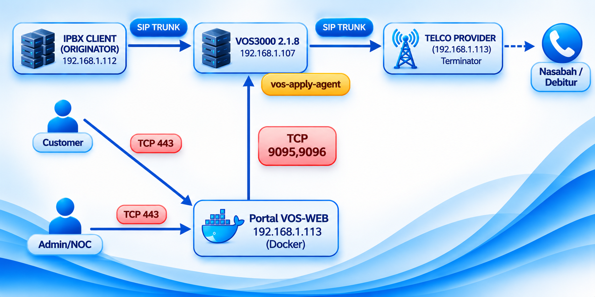

# Panduan Deployment VOS3000 Host Agent (`vos-apply-agent`)
### VoxaGrid Zero-Exposure Softswitch Bridge & Host Monitor Daemon

Dokumen ini adalah panduan resmi instalasi, arsitektur keamanan, konfigurasi, dan pemeliharaan paket **`vos-apply-agent`** yang dipasang langsung pada **Mesin Host Softswitch VOS3000**.

---

## 1. Peran `vos-apply-agent` dalam Arsitektur Sistem

Dalam ekosistem **VOS-WEB Management Suite**, paket **`vos-apply-agent`** bertugas sebagai jembatan internal (*In-Host Bridge & Security Proxy*) yang dipasang di dalam server **VOS3000 2.1.8**. Agent ini menerima instruksi dari **Portal VOS-WEB (`apps`)** melalui **TCP Port `9095` & `9096`**.



### Diagram Alur Kerja `vos-apply-agent` di Mesin Host VOS3000
```text
  +-----------------------------------------+
  |       Portal VOS-WEB (Paket apps)       |
  |       e.g. 192.168.1.113 (Docker)       |
  +--------------------+--------------------+
                       |
                       |  HTTP/REST via TCP Port 9095 & 9096
                       |  Dilindungi 3 Lapis Keamanan:
                       |  1. Firewall Kernel (iptables Whitelist IP)
                       |  2. Application Whitelist (ALLOWED_IPS di agent.conf)
                       |  3. Header Token (X-VOS-Agent-Key: AGENT_SECRET)
                       v
  +===================================================================================+
  |                     MESIN HOST SOFTSWITCH VOS3000 (e.g. 192.168.1.107)            |
  |                                                                                   |
  |  +--------------------------------------+  +-----------------------------------+  |
  |  |   Port 9095 : VosApplyAgent (In-JVM) |  | Port 9096 : VosHostMonitor (Root) |  |
  |  |   Di-attach ke JVM proses vos3000d   |  | Daemon mandiri di bawah Systemd   |  |
  |  +------------------+-------------------+  +-----------------+-----------------+  |
  |                     |                                        |                    |
  |     +---------------+---------------+        +---------------+---------------+    |
  |     |                               |        |               |               |    |
  |     v                               v        v               v               v    |
  |  +----------------------+  +---------------+ +------------+ +------------+ +----+ |
  |  | Memori RAM MitCommon |  | Trace Buffer  | | Tomcat API | | MySQL 5.0  | | 10 | |
  |  | & MGC Broadcast      |  | /home/kunshi/ | | 127.0.0.1  | | 127.0.0.1  | | VOS| |
  |  | QMBX_SYNCHRONIZE_REQ |  | mbx3000/trace | | Port 6099  | | Port 3306  | | Svc| |
  |  | (Tombol Apply &      |  | callflow_0/1  | | (Tertutup  | | (Tertutup  | | Mon| |
  |  |  Global/GW Trace)    |  | (SIP Ladder)  | |  dr Luar)  | |  dr Luar)  | |    | |
  |  +----------------------+  +---------------+ +------------+ +------------+ +----+ |
  +===================================================================================+
```

---

## 2. Fungsi Detail Port `9095` & Port `9096`

Paket `vos-apply-agent` berjalan sebagai Systemd service (`vos-apply-agent.service`) menggunakan Java Runtime internal bawaan VOS3000 (`/home/kunshi/base/jdk_default`), tanpa membebani performa panggilan softswitch:

| Port | Komponen | Mode Eksekusi | Fungsi Utama |
| :--- | :--- | :--- | :--- |
| **`9095`** | **`VosApplyAgent`** | In-JVM Dynamic Attach (`vos3000d`) | 1. **Instant Softswitch Apply**: Memicu sinkronisasi memori routing/gateway seketika (*Body ID 8008115 / QMBX_SYNCHRONIZE_REQ*) ke `mbx3000d`.<br>2. **Rate Group Ownership Fix**: Memperbaiki kepemilikan grup tarif (`user_id=1`) di RAM `MitCommon` & MySQL.<br>3. **SIP Debug Trace & Packet Capture**: Mengaktifkan/menonaktifkan trace sinyal global (*Body ID 8008123*) maupun per-gateway, serta mengekstrak paket SIP Leg-A & Leg-B dari file ring buffer `/home/kunshi/mbx3000/trace/callflow_0` & `callflow_1` untuk ditampilkan sebagai diagram tangga SIP (*SIP Ladder Diagram*) dan file `.pcap` (Wireshark) di Portal VOS-WEB. |
| **`9096`** | **`VosHostMonitor`** | Standalone Root Daemon | 1. **Secure VOS API Proxy (`127.0.0.1:6099`)**: Meneruskan request API VOS3000 secara lokal tanpa perlu membuka port Tomcat 6099 ke jaringan luar.<br>2. **Secure MySQL Proxy (`127.0.0.1:3306`)**: Menjalankan penarikan CDR (streaming), analisis gateway, DB Explorer, dan sinkronisasi whitelist via loopback lokal tanpa membuka port MySQL 3306 ke luar.<br>3. **Process & Daemon Monitor**: Memantau CPU, RAM, PID, dan Uptime ke-10 daemon VOS3000 (`mbx3000d`, `vos3000d`, `empd`, `callserviced`, `mgcd`, `webserverd`, `webdatad`, `audioplayerd`, `mediarecordd`, `servermonitord`) langsung dari `/proc` kernel (< 1 ms) serta melayani kontrol restart service. |

### Keunggulan Keamanan Arsitektur *Zero-Exposure*:
* **Port MySQL (`3306`) & Port Tomcat (`6099`) DITUTUP TOTAL dari jaringan luar** melalui `iptables` (`! -s 127.0.0.1 -j DROP`).
* **Tidak memerlukan pembuatan user remote MySQL**. Koneksi ke MySQL dilakukan 100% secara lokal (`127.0.0.1:3306`) oleh daemon agent menggunakan akun lokal bawaan VOS3000 (`root` tanpa password, atau sesuai konfigurasi di `agent.conf`).
* Seluruh komunikasi dari server **Portal VOS-WEB** ke Port `9095` dan `9096` dilindungi oleh **3 Lapis Keamanan**:
  1. **Firewall Kernel (`iptables`)**: Hanya IP server Portal VOS-WEB yang diizinkan mengakses port `9095` & `9096`.
  2. **Application IP Whitelist (`ALLOWED_IPS`)**: Validasi alamat IP pemanggil di `agent.conf`.
  3. **Shared Secret Header (`X-VOS-Agent-Key`)**: Validasi token rahasia (`AGENT_SECRET`) pada setiap HTTP request.

---

## 3. Kebutuhan Sistem Host VOS3000

* **Sistem Operasi**: CentOS 6.x / 7.x, RHEL, AlmaLinux, atau Rocky Linux (yang telah terinstal VOS3000).
* **Versi VOS3000**: Mendukung VOS3000 v2.1.8.05, v2.1.8.00, v2.1.7.0, dan kompatibel.
* **Java Runtime**: Otomatis menggunakan `/home/kunshi/base/jdk_default` bawaan VOS3000 (tidak perlu menginstal Java tambahan).
* **Hak Akses**: `root` pada mesin softswitch VOS3000.

---

## 4. Langkah-Langkah Deployment di Mesin VOS3000 (1-Click Install)

### Langkah 1: Unggah Paket `vos-apply-agent` ke Mesin VOS3000
Salin folder `vos-apply-agent` ke mesin softswitch VOS3000 Anda (misal ke `/tmp/vos-apply-agent`):

```bash
scp -r vos-apply-agent root@<IP_SERVER_VOS3000>:/tmp/
```

### Langkah 2: Jalankan Script Instalasi Otomatis (`deploy.sh`)
Login ke mesin VOS3000 melalui SSH sebagai `root`, masuk ke folder paket, dan jalankan `deploy.sh` dengan menyertakan **IP Server Portal VOS-WEB** Anda (contoh pada diagram: `192.168.1.113`):

```bash
ssh root@<IP_SERVER_VOS3000>
cd /tmp/vos-apply-agent

# Untuk 1 Server Portal VOS-WEB (ganti dengan IP Server VOS-WEB Anda):
bash deploy.sh 192.168.1.113

# Atau jika Anda memiliki beberapa Server Portal VOS-WEB (pisahkan dengan koma tanpa spasi):
bash deploy.sh 192.168.1.113,192.168.1.114
```

> [!TIP]
> Jika Anda menjalankan `bash deploy.sh` tanpa argumen IP, script akan menampilkan prompt interaktif untuk menanyakan IP Server Portal VOS-WEB Anda. Jika Portal VOS-WEB diinstal di mesin yang sama dengan VOS3000, masukkan `127.0.0.1`.

### Apa yang Dilakukan `deploy.sh` Secara Otomatis?
1. **Penonaktifan SELinux & Firewalld**: Menonaktifkan SELinux dan mematikan `firewalld` agar tidak mengganggu trafik SIP/RTP maupun Agent.
2. **Instalasi Paket Pendukung**: Memastikan `curl`, `wget`, `jq`, `tar`, `gzip`, `openssl`, `iproute`, `procps`, dan `net-tools` tersedia.
3. **Instalasi Permanen**: Menyalin seluruh file biner terobfuskasi (`bin/vos-apply-agent.jar`, `bin/attach.jar`), library JDBC (`lib/mysql-connector-java-5.1.49.jar`), serta script watchdog ke **`/home/kunshi/services/vos-apply-agent/`**.
4. **Registrasi Systemd Service**: Memasang dan mengaktifkan `/etc/systemd/system/vos-apply-agent.service` (`Restart=always`).
5. **Patch Boot-Safe `servermonitord`**: Memasang wrapper `/usr/sbin/runlevel` dan memperbaiki urutan start `servermonitord` agar tabel Process Monitor di VOS3000 Client GUI tidak pernah kosong setelah server reboot.
6. **Otomasi Whitelist & Firewall Zero-Exposure**:
   * Menambahkan IP Server Portal VOS-WEB ke `ALLOWED_IPS` di `/home/kunshi/services/vos-apply-agent/agent.conf`.
   * Menambahkan `127.0.0.1` dan IP Portal VOS-WEB ke `/home/kunshiweb/base/apache-tomcat/conf/webserver_access_control.conf` serta tabel MySQL `vos3000.e_web_access_control` (ID 101 & 102), lalu me-reload Tomcat (`webserverd`).
   * Mengatur `iptables`: membuka port `9095` & `9096` khusus untuk IP Portal VOS-WEB, mengunci port `3306` (MySQL) & `6099` (Tomcat) hanya untuk `127.0.0.1`, dan menyimpan aturan ke `/etc/sysconfig/iptables`.
7. **Post-Deploy Healthcheck Guard**: Menguji keempat endpoint kesehatan lokal (`:9095/health`, `:9096/health`, `:9096/health/vos-api`, dan `:9096/health/mysql`) hingga semuanya berstatus **ONLINE / HEALTHY (200 OK)**.

---

## 5. Konfigurasi `agent.conf`

File konfigurasi utama berada di `/home/kunshi/services/vos-apply-agent/agent.conf`:

```ini
# ==============================================================================
# VOS3000 Agent Security & Local Database Configuration (Port 9095 & Port 9096)
# ==============================================================================
# Lapis 1: Daftar IP yang diizinkan mengakses port 9095 & 9096 (pisahkan koma)
ALLOWED_IPS=127.0.0.1,::1,0:0:0:0:0:0:0:1,192.168.1.113

# Lapis 2: Shared Secret Key yang wajib dikirim via header X-VOS-Agent-Key
AGENT_SECRET=voxagrid-agent-secret-2026

# Lapis 3: Konfigurasi Koneksi MySQL Lokal VOS3000 (Loopback 127.0.0.1:3306)
# Secara default instalasi VOS3000 menggunakan user "root" tanpa password ("").
MYSQL_LOCAL_HOST="127.0.0.1"
MYSQL_LOCAL_PORT="3306"
MYSQL_LOCAL_DB="vos3000"
MYSQL_LOCAL_USER="root"
MYSQL_LOCAL_PASS=""
```

> [!NOTE]
> Setiap perubahan pada `/home/kunshi/services/vos-apply-agent/agent.conf` (baik penambahan IP baru pada `ALLOWED_IPS`, perubahan `AGENT_SECRET`, maupun pengisian `MYSQL_LOCAL_PASS` jika MySQL lokal diberi password) **dibaca secara otomatis dan dinamis** oleh Agent pada setiap request tanpa perlu me-restart service.

---

## 6. Verifikasi & Perintah Pemeliharaan Harian

Jalankan perintah berikut pada mesin VOS3000 untuk memeriksa kesehatan layanan:

```bash
# 1. Cek status service systemd
systemctl status vos-apply-agent.service

# 2. Restart service agent (jika diperlukan)
systemctl restart vos-apply-agent.service

# 3. Pantau log aktivitas agent secara live
journalctl -u vos-apply-agent.service -f
tail -f /var/log/vos-host-monitor.log

# 4. Uji manual ke-4 endpoint kesehatan dari terminal lokal VOS3000
AGENT_KEY=$(grep '^AGENT_SECRET=' /home/kunshi/services/vos-apply-agent/agent.conf | cut -d'=' -f2 | tr -d '\"\r ')
curl -s http://127.0.0.1:9095/health
curl -s http://127.0.0.1:9096/health
curl -s -H "X-VOS-Agent-Key: $AGENT_KEY" http://127.0.0.1:9096/health/vos-api
curl -s -H "X-VOS-Agent-Key: $AGENT_KEY" http://127.0.0.1:9096/health/mysql
```

---
**VOS3000 Web Management © 2026 VoxaGrid Systems**  
Kontak & Dukungan Teknis: `info@voxagrid.net` | `masteringvoip@gmail.com` | [www.voxagrid.net](https://www.voxagrid.net)
